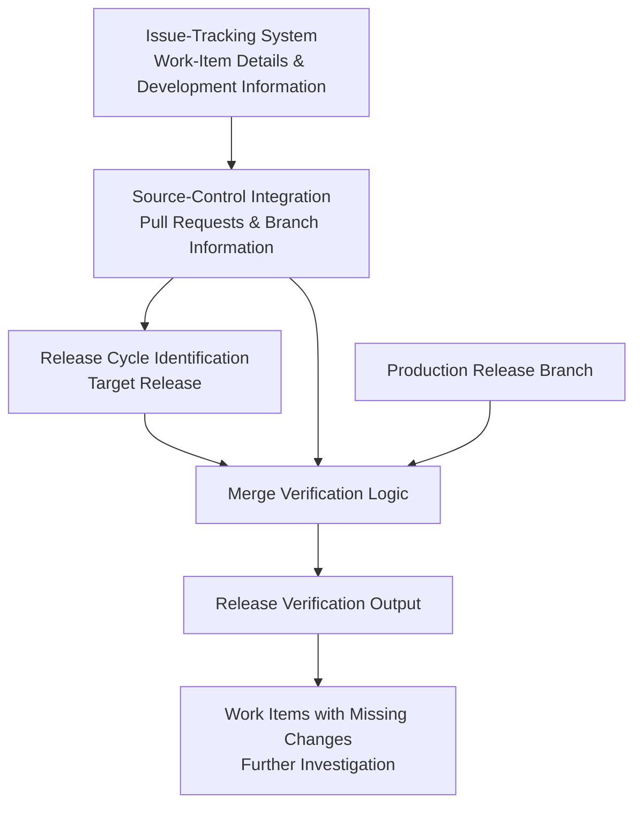

# AI Powered Release Management Verification

## NOTE: This is an independently created technical blueprint based on concepts and learnings from a professional project developed during my employment. It is intended for technical reference and demonstration purposes and does not contain any proprietary source code or confidential information.

## 1. Background

Enterprise software development involves multiple release cycles and branching strategies. Work-item changes typically move through development, testing, and release branches before reaching production.

This project introduces an automated Release Management Tool that connects work-item tracking with source-control information to verify whether associated code changes have been incorporated into the intended production release branch.

## 2. Problem Statement

Tracking whether a work item's code changes have reached a production release branch can be difficult in complex branching environments.

Although work items and pull requests provide visibility into development progress, they do not always make it straightforward to determine whether the corresponding changes have been merged into the correct production release branch.

Developers and release teams must manually cross-reference tickets, pull requests, release cycles, and branch histories to establish release readiness.

## 3. Existing Limitations

- **Branching Complexity:** Changes move across multiple development, testing, and release branches.
- **Fragmented Information:** Work-item status and pull request information are maintained in separate systems.
- **Manual Verification:** Developers must independently trace pull requests and verify their presence in production release branches.
- **Release Visibility Gaps:** A completed or merged pull request does not necessarily mean its changes are included in the intended production release.
- **Risk of Missing Changes:** Changes can be overlooked when validating release readiness manually.

## 4. Proposed System

An automated release verification prototype that retrieves work-item details and associated pull request information from issue-tracking and source-control systems.

The tool identifies the relevant release cycle and checks whether the corresponding pull request changes have been merged into the production release branch.

It helps surface work items whose associated changes are missing from the intended release branch, improving release-readiness visibility and reducing manual verification effort.

## 5. Key Capabilities

- **Work-Item Retrieval:** Fetch relevant ticket details from the issue-tracking system.
- **Pull Request Correlation:** Identify pull requests associated with each work item.
- **Release Cycle Identification:** Determine the relevant release cycle for the work item.
- **Branch Verification:** Examine source-control information to verify whether associated changes reached the production release branch.
- **Missing Merge Detection:** Identify work items whose changes are not present in the intended production release branch.
- **Release Readiness Visibility:** Provide a consolidated view to support release verification.

## 6. Architecture

The solution combines the following components:

## 7. Evaluation

The prototype was evaluated based on its ability to correlate work items with pull requests, identify the relevant release cycle, and verify whether changes were included in the intended production release branch.

| Evaluation Metric                | How It Applies to the Prototype                                                                                   | Observed Results                                                                                                            |
| -------------------------------- | ----------------------------------------------------------------------------------------------------------------- | --------------------------------------------------------------------------------------------------------------------------- |
| **Work-Item to PR Correlation**  | Measures whether the correct pull requests are identified for a given work item.                                  | Connected work-item information with its associated pull request details, reducing independent cross-system lookups.        |
| **Release Cycle Identification** | Evaluates whether the relevant release cycle is identified for each work item.                                    | Established the target release context for verifying whether changes were included in the intended release.                 |
| **Merge Verification Accuracy**  | Measures whether the tool correctly determines if associated changes have reached the production release branch.  | Enabled verification against the target production release branch instead of relying only on ticket or pull request status. |
| **Missing Merge Detection**      | Measures the ability to identify work items whose changes are absent from the intended production release branch. | Surfaced missing changes that could otherwise be overlooked during manual release checks.                                   |
| **Release Verification Time**    | Compares the effort required for automated verification against manual cross-checking.                            | Reduced repetitive navigation and manual comparison across work items, pull requests, and release branches.                 |

## 8. Results and Impact

- **Reduced Manual Cross-Checking:** Automated the retrieval and correlation of work items, pull requests, and release branch information.
- **Improved Release Visibility:** Made it easier to determine whether development changes had reached the intended production release.
- **Early Missing Merge Identification:** Helped surface work items whose changes were absent from the target production release branch.
- **More Reliable Release Verification:** Reduced dependence on ticket status or individual manual checks as indicators of release inclusion.
- **Improved Release Readiness:** Provided developers and release teams with better visibility into outstanding changes before production release.

## 9. Future Enhancements

- **Automated Release Reports:** Generate consolidated reports of work items and their production release inclusion status.
- **Multi-Release Verification:** Extend verification across multiple release cycles and production branches.
- **Missing Merge Notifications:** Alert developers and release teams when expected changes are absent from target branches.
- **Commit-Level Verification:** Strengthen validation by tracing associated commits and comparing changes across branches.
- **CI/CD Integration:** Incorporate release verification into deployment pipelines.
- **Release Readiness Dashboard:** Provide centralized visibility into verified, pending, and missing changes.

## 10. Conclusion

The Release Management Tool demonstrates how automation and cross-system data correlation can improve enterprise release verification.

By connecting work items, pull requests, release cycles, and production branch information, the prototype addresses a practical gap in complex release workflows: determining whether intended code changes have actually reached production release branches.

It reduces manual verification effort, helps identify missing merges, and provides better visibility into release readiness.
